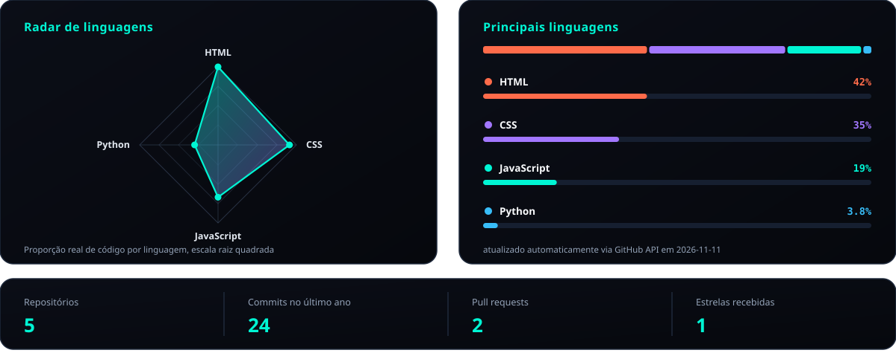

  <!-- ======================= 🌌 TOPO: HERO BANNER HIGH-TECH ======================= -->
  

   

  <!-- Subtítulo Dinâmico -->
  

 

<!-- ======================= 🧬 BENTO GRID: SOBRE MIM & LIFESTYLE ======================= -->

  

 

<table>
  <tr>
    <td width="100%">
      <h3>🚀 Sobre Mim &nbsp;•&nbsp; <i>About Me</i></h3>
      

        Sou o <b>Caio</b> (<code>@Z4Caio</code>), desenvolvedor focado em <b>Front-End (Web &amp; Mobile)</b> e <b>UI/UX Design</b>. Acredito que construir ótimos softwares exige a mesma mentalidade dos meus dois maiores hobbies fora das telas:
      

      <ul>
        <li>🏋️‍♂️ <b>Mentalidade de Academia (Disciplina &amp; Constância):</b> Evolução diária, foco nos fundamentos e sobrecarga progressiva nos estudos de código.</li>
        <li>🐠 <b>Olhar do Aquarismo (Ecossistemas &amp; UI/UX):</b> Paciência para ajustar cada detalhe até que o visual, a performance e a usabilidade funcionem em perfeita harmonia.</li>
        <li>💻 <b>Foco técnico atual:</b> Criando interfaces e soluções com <code>HTML5</code>, <code>CSS3</code>, <code>JavaScript</code> e <code>Python</code>.</li>
        <li>📈 <b>Expandindo horizontes:</b> Aprofundando estudos em <code>React</code>, <code>Node.js</code>, <code>SQL</code> e <code>Docker</code>.</li>
      </ul>
    </td>
  </tr>
</table>

 

<!-- ======================= 🚀 CENTRO: MEUS PROJETOS REAIS ======================= -->

  <h2>⚡ Projetos &nbsp;•&nbsp; <i>Featured Projects</i></h2>
  
<i>Aplicações e interfaces desenvolvidas por mim • Clique para testar ao vivo ou explorar o código-fonte</i>

<table width="100%">
  <tr>
    <td width="50%" valign="top">
      <h3>🎣 Fishing Landing</h3>
      

        Página sobre pesca esportiva no Brasil. Cada região abre relevo, espécies, equipamento e uma tática de arremesso.
      

      

        <code>HTML5</code> &nbsp;•&nbsp; <code>CSS3</code> &nbsp;•&nbsp; <code>JavaScript</code>
      

      

        
        &nbsp;
        
      

    </td>
    <td width="50%" valign="top">
      <h3>💎 Clínica de Estética</h3>
      

        Landing da Élégance: procedimentos, diferenciais e uma vista do rosto para explorar cada área.
      

      

        <code>HTML5</code> &nbsp;•&nbsp; <code>CSS3</code> &nbsp;•&nbsp; <code>JavaScript</code>
      

      

        
        &nbsp;
        
      

    </td>
  </tr>
  <tr>
    <td width="50%" valign="top">
      <h3>⚖️ Advocacia</h3>
      

        Página de escritório com áreas de atuação, depoimentos, horários e um bloco de contato.
      

      

        <code>HTML5</code> &nbsp;•&nbsp; <code>CSS3</code> &nbsp;•&nbsp; <code>JavaScript</code>
      

      

        
        &nbsp;
        
      

    </td>
    <td width="50%" valign="top">
      <h3>🤱 Mãe Conecta</h3>
      

      Fork de um projeto voltado à criação de uma rede de apoio para mães. Realizei melhorias na interface e na apresentação visual, buscando tornar a experiência mais agradável e intuitiva. Desenvolvido em HTML, CSS e JavaScript.
      

      

        <code>HTML5</code> &nbsp;•&nbsp; <code>CSS3</code> &nbsp;•&nbsp; <code>JavaScript</code>
      

      

        
        &nbsp;
        
      

    </td>
  </tr>
</table>

 

<!-- ======================= 📊 CAPACIDADES, LINGUAGENS REAIS & FERRAMENTAS ======================= -->

  <h2>🧠 Linguagens, Atividade &amp; Ferramentas</h2>
  
<i>Dados reais validados do perfil <b>@Z4Caio</b> e atualizados automaticamente por GitHub Actions + API</i>

  <!-- Radar de Linguagens Real + Principais Linguagens Reais + Contadores Reais -->
  

    

  <!-- Ícones de Ferramentas & Tecnologias -->
  <table width="100%">
    <tr>
      <td align="center" width="55%" valign="top">
        <h4>⚡ Tecnologias &amp; Ferramentas que Uso</h4>
        

          
        

      </td>
      <td align="center" width="45%" valign="top">
        <h4>🚀 Próximos Passos (Estudando)</h4>
        

          
        

      </td>
    </tr>
  </table>

 

<!-- ======================= 📈 STATUS DO GITHUB EM TEMPO REAL ======================= -->

  <h2>📊 GitHub Status &amp; Contribuições em Tempo Real</h2>
  
<i>Widgets conectados diretamente à API do GitHub (atualizados a cada commit, PR ou estrela)</i>

  
  

    

  

    

  <!-- Pac-Man Contribution Graph (Atualizado via GitHub Actions) -->
  <picture data-importer="pacman">
    <source media="(prefers-color-scheme: dark)" srcset="https://raw.githubusercontent.com/Z4Caio/Z4Caio/pacman-output/pacman-contribution-graph-dark.svg?game=pacman">
    <source media="(prefers-color-scheme: light)" srcset="https://raw.githubusercontent.com/Z4Caio/Z4Caio/pacman-output/pacman-contribution-graph.svg?game=pacman">
    
  </picture>

 

<!-- ======================= 🤝 FINAL: FORMAS DE ENTRAR EM CONTATO ======================= -->

  <h2>🤝 Vamos Conversar? &nbsp;•&nbsp; <i>Contacts</i></h2>
  
<i>Aberto a oportunidades, projetos freelance, networking ou um bom papo sobre código, treino e aquarismo!</i>

  

    
    
    
    
  

   

  <!-- Banner Visual Final -->
  

