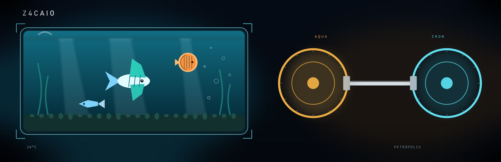

# Olá, me chamo Caio e esse é meu GitHub

Construo páginas e interfaces para a web: estrutura clara, visual cuidado e interação no navegador. 
A academia entra como ritmo. O aquarismo, como composição — luz, proporção e paciência com o detalhe.

## Projetos

<table>
<tr>
<td width="50%" valign="top">

### Fishing Landing
Página sobre pesca esportiva no Brasil. Cada região abre relevo, espécies, equipamento e uma tática de arremesso.

[Ver ao vivo](https://z4caio.github.io/FishingLanding/) · [Código](https://github.com/Z4Caio/FishingLanding)

</td>
<td width="50%" valign="top">

### Clínica de Estética
Landing da Élégance: procedimentos, diferenciais e uma vista do rosto para explorar cada área.

[Ver ao vivo](https://z4caio.github.io/Clinica_de_Estetica/) · [Código](https://github.com/Z4Caio/Clinica_de_Estetica)

</td>
</tr>
<tr>
<td width="50%" valign="top">

### Advocacia
Página de escritório com áreas de atuação, depoimentos, horários e um bloco de contato.

[Ver ao vivo](https://z4caio.github.io/Advocacia-LandingPage/) · [Código](https://github.com/Z4Caio/Advocacia-LandingPage)

</td>
<td width="50%" valign="top">

### Mãe Conecta
Protótipo de uma rede para mães: vagas afirmativas, apoio e divulgação de pequenos negócios. Fork em HTML, CSS e JavaScript.

[Ver ao vivo](https://z4caio.github.io/remae-prototipo/) · [Código](https://github.com/Z4Caio/remae-prototipo)

</td>
</tr>
</table>

## O que eu uso

Landing pages com narrativa e chamada para ação. 
Layout em CSS, interação em JavaScript e publicação com GitHub Pages.

 

## No GitHub

<table>
<tr>
<td valign="top">

</td>
<td valign="top">

</td>
</tr>
</table>

Gráfico de contribuições em modo arcade

 
<picture>
  <source media="(prefers-color-scheme: dark)" srcset="https://raw.githubusercontent.com/Z4Caio/z4caio/pacman-output/pacman-contribution-graph-dark.svg?game=pacman">
  <source media="(prefers-color-scheme: light)" srcset="https://raw.githubusercontent.com/Z4Caio/z4caio/pacman-output/pacman-contribution-graph.svg?game=pacman">
  
</picture>

## Contato

Se quiser falar de um projeto, estes são os caminhos.

  

&nbsp;

&nbsp;

 

Petrópolis — Rio de Janeiro

